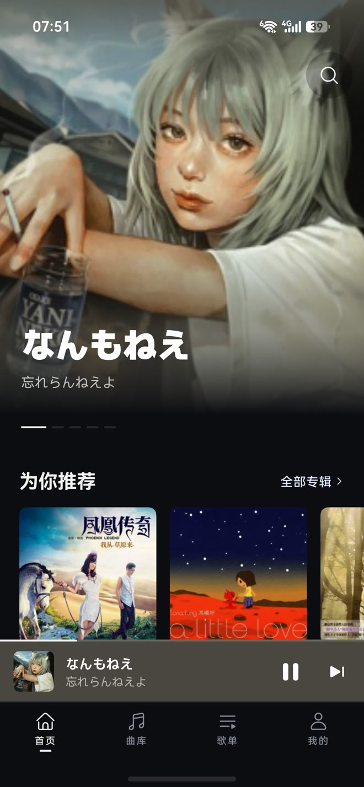
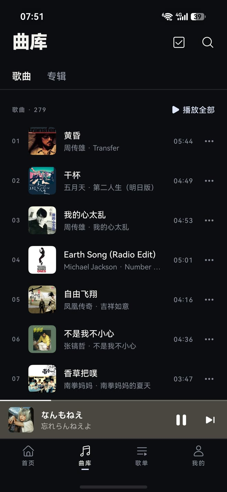
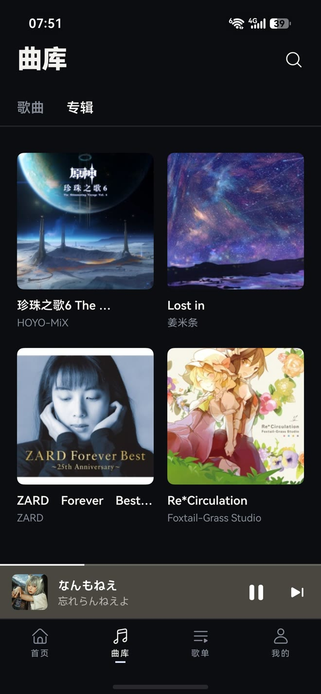
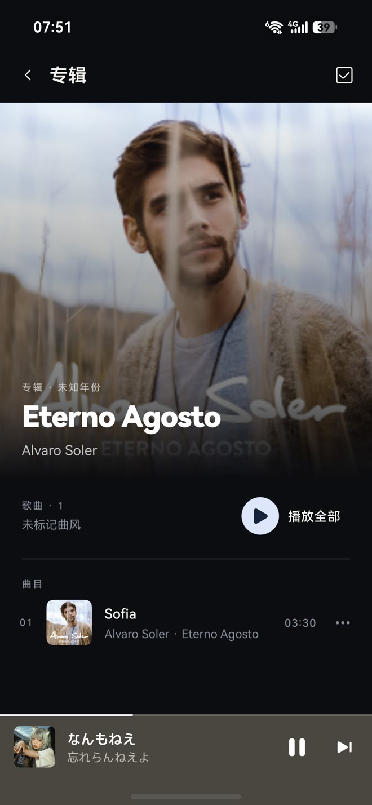
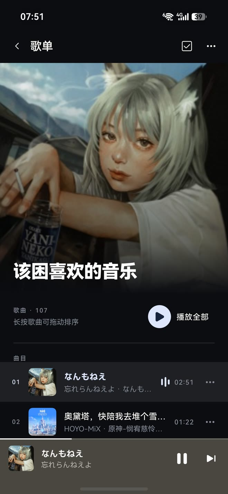

# 简音 / JianYin

**本项目完全由 AI 开发，仅供作者自己自用。**

**This project was developed entirely by AI and is maintained for the author's personal use.**

简音是一个 HarmonyOS / Android 双端音乐播放器，用 ArkUI-X 和 ArkTS 编写，一套界面同时运行在两个平台。它面向自托管音乐库：打开就能看到封面、推荐、专辑和艺人，播放、队列、歌词、搜索、歌单都在熟悉的位置。界面克制、动画流畅、信息层级清楚；音乐数据留在你自己的服务器上，不绑定云账号，也不锁定单一后端。

## 预览

<table>
  <tr>
    <td align="center"><br><sub>首页</sub></td>
    <td align="center"><br><sub>曲库 · 歌曲</sub></td>
    <td align="center"><br><sub>曲库 · 专辑</sub></td>
    <td align="center"><br><sub>歌单</sub></td>
    <td align="center"><br><sub>专辑</sub></td>
    <td align="center"><br><sub>播放器</sub></td>
  </tr>
</table>

## 支持的后端

- **GuoBeng**：本项目配套的自有后端（原 MusicServer），[GitHub 仓库](https://github.com/ManaNeko-nya/guobeng-music-backend)。
- **Navidrome / Subsonic**：支持标准 Subsonic API 的自托管音乐服务，[Navidrome](https://github.com/navidrome/navidrome)。
- **游客模式**：未开放登录的服务也可以直接浏览；评论、歌单、添加到歌单等依赖账号的功能会自动隐藏。
- 中英双语：设置中可跟随系统，或手动选择中文 / English；语言或服务器切换后需要重启 App。

## 主要功能

- 首页推荐、专辑、艺人、曲库、搜索、歌单。
- 播放队列、顺序 / 列表循环 / 单曲循环 / 随机播放、倍速、歌词。
- 系统媒体会话、锁屏 / 通知控制、Android 前台媒体服务。
- 共享的歌曲列表控件：多选、分页、拖动排序（后端支持时）、定位当前播放歌曲。
- 统一标题栏、底部弹窗、列表和播放器界面，每页私有 UI 状态。
- Subsonic 能力降级：后端不支持的评论、注册、歌单排序直接隐藏。

## 软件架构

```text
UI (ArkUI V2 / ArkUI-X)
  ├─ 共享组件：标题栏、歌曲列表、弹窗、播放条、封面
  ├─ 页面状态：每个页面持有自己的 TopBarState / ViewModel
  └─ 平台壳：ArkUI-X Android（.arkui-x/android）+ HarmonyOS

数据层
  └─ MusicRepository（稳定门面）
      ├─ JianYinProvider  → GuoBeng 自有后端
      └─ SubsonicProvider → Navidrome / Subsonic API
          ├─ token + salt 鉴权
          ├─ 字符串 ID ↔ 数字 ID 适配
          └─ 能力标记（评论、注册、歌单排序等）

播放层
  ├─ ArkTS AVPlayer（两端）
  ├─ HarmonyOS AVSession + 后台任务
  └─ Android MediaSession + 前台媒体服务 + 通知

本地化
  └─ resources/base（中文）+ resources/en（英文）
      └─ data/L10n.ets 统一取词与格式化
```

### 数据层

- 页面只调用 `MusicRepository`，不直接拼简音或 Subsonic 的 URL。
- `MusicRepository` 根据当前服务选择 `JianYinProvider` 或 `SubsonicProvider`。
- Subsonic 的字符串 ID 在 Provider 内部映射成 UI 使用的数字 ID；路由和播放队列不需要感知协议。
- 能力标记决定 UI 是否显示评论、注册、歌单拖动排序等入口。

### 播放与系统能力

- 两端都用 ArkTS AVPlayer 解码；Android 通过 Java 桥接启动前台媒体服务、MediaSession 和通知。
- HarmonyOS 使用 AVSession 和后台任务。
- 封面/音频 URL 由 Provider 生成；Subsonic 的鉴权参数直接放在 URL 中，现有图片和播放器不需要额外请求头。

### 本地化

- 默认跟随系统语言；设置中可手动选择中文或 English。
- 语言和服务器切换都需要重启 App 后生效，避免半刷新状态。
- 静态文案在 `resources/base` 与 `resources/en`，动态计数通过 `L10n.fmt()` 使用资源格式化。
- 服务端返回的错误原文保留；客户端网络/状态错误有中英资源。

## 目录

```text
entry/src/main/ets/
  data/        模型、仓库门面、Provider、L10n、会话
  playback/    播放引擎、系统媒体会话
  platform/    ArkUI-X / Android 桥
  ui/          页面、共享组件、主题、导航
.arkui-x/android/   Android 壳与 Gradle 工程（不含签名配置）
AppScope/          应用级配置
```

## 构建

环境要求：

- DevEco Studio / HarmonyOS SDK（兼容 API 24）
- ArkUI-X SDK 26.0.0
- JDK 21
- Android SDK 34 + Build Tools 34
- Node.js / ace CLI

```bash
# 在本机准备（不要提交）
# 1. 在 DevEco 中配置 HarmonyOS 签名，生成根目录 build-profile.json5
# 2. 在 .arkui-x/android/keystore.properties 填写本地 keystore

node "$ARKUI_X/toolchains/ace_tools/lib/ace_tools.js" build apk
node "$ARKUI_X/toolchains/ace_tools/lib/ace_tools.js" build hap
```

仓库**不包含**任何签名文件、签名密码、本机路径或 IDE 设置；请自行配置。`build-profile.example.json5` 和 `keystore.properties.example` 只提供结构示例。

## 相关仓库

- 客户端：<https://github.com/ManaNeko-nya/jianyin-music>
- GuoBeng 后端：<https://github.com/ManaNeko-nya/guobeng-music-backend>
- Navidrome：<https://github.com/navidrome/navidrome>

## License

MIT
